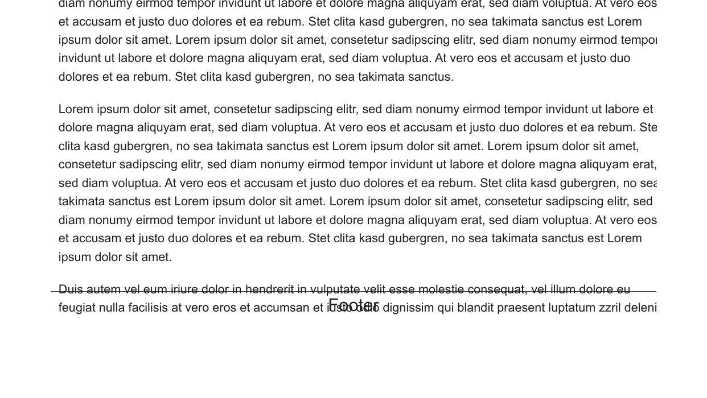
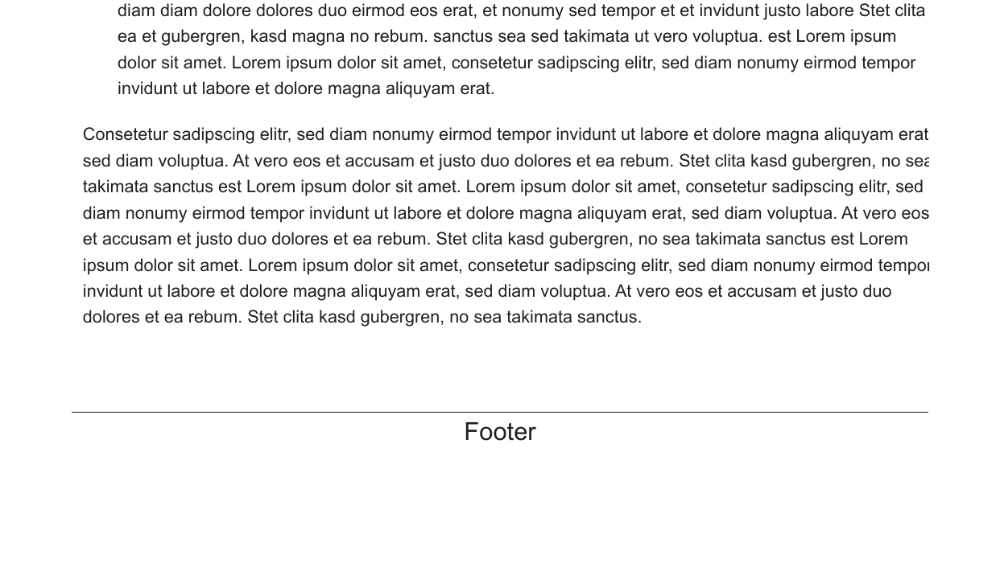

# PDF footer spacing evidence for MarkText #5984

These images show the lower portion of page 6 before and after the footer-group correction, using identical page crop coordinates. The document is derived from the Markdown supplied in [the public bug report](https://github.com/marktext/marktext/issues/5984), with the academic theme, 14px Arial body text at 1.5 line height, 20px styled header and footer, 25mm top/bottom margins and 15mm left/right margins.

The HTML was generated by the current production `exportStyledHTML` implementation and printed with Electron 45.0.0 / Chromium 156.0.8078.48 on Windows. The before version uses the unchanged exporter at b4854d2; the after version changes the footer spacer to `display: table-footer-group`.

This is renderer-level PDF evidence. The complete desktop-menu export and Linux Flatpak build were not tested: rebuilding the Windows native `ced` dependency requires Visual Studio C++ tools unavailable in this environment.

The production PR contains the CSS fix and regression tests only. These evidence images are kept on a separate branch of the contributor's fork.
